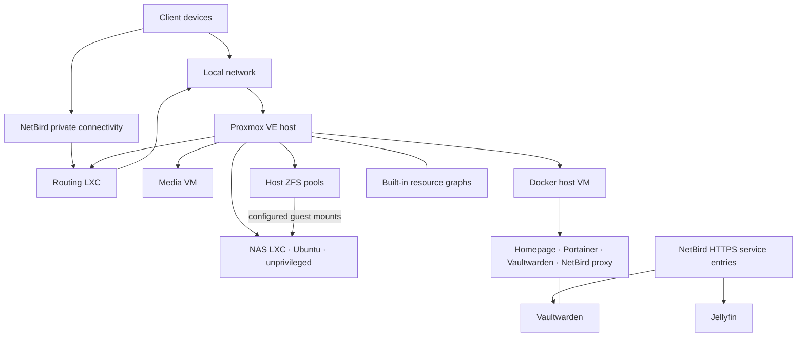
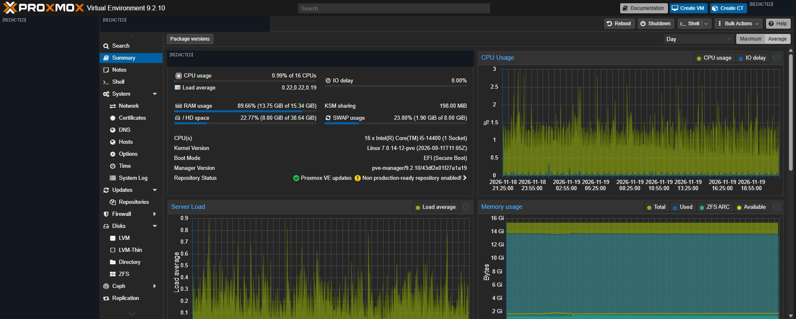
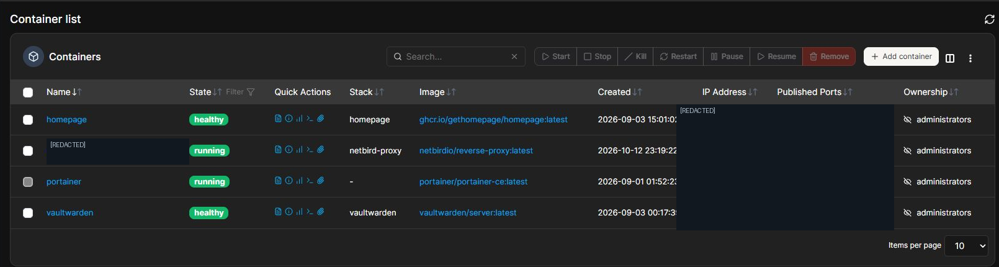

# Home Lab Infrastructure

A personal environment for learning how everyday services work, from the hardware underneath them to virtualization, storage, containers, and private connectivity.

I built this lab to extend my passion for building computers into understanding the services I use every day. Its current workloads include media applications, a password-management service, network storage, and infrastructure management.

**Documentation snapshot: November 19, 2026 (America/Chicago).** This project records a read-only inspection of the running environment through existing browser sessions. It contains documentation and sanitized evidence, rather than deployment configuration. Operational observations describe that inspection, not an availability guarantee.

## At a glance

| Layer | Verified environment |
| --- | --- |
| Host | One Proxmox VE 9.2.10 node; Intel Core i5-14400; 16 logical CPUs; 15.34 GiB reported RAM |
| Virtualization | Two running QEMU VMs and two running LXC containers |
| Application management | Docker Engine 29.7.2 and Portainer CE 2.45.0 LTS on an Ubuntu 26.04 LTS Docker host |
| Storage | Three host ZFS pools reported ONLINE; two large NAS guest mounts configured as 20000G and 12000G |
| Connectivity | NetBird peers, one active LAN resource, one routing peer, and two HTTPS reverse-proxy service entries |
| Visibility | Proxmox resource graphs, Portainer state and health reporting, Homepage widgets, application health pages |

## Technologies

- **Compute and operating systems:** Proxmox VE, QEMU virtual machines, LXC, Linux, Ubuntu.
- **Containers and management:** Docker, Portainer Community Edition, Homepage.
- **Storage:** ZFS, LVM-backed guest disks, LXC mount points.
- **Networking:** NetBird, LAN routing, HTTPS reverse proxy.
- **Applications:** Jellyfin, Seerr (dashboard label: Jellyseerr), Sonarr, Bazarr, and Vaultwarden. Additional linked applications and access limits are in the [service inventory](docs/services.md).

These are observed technologies. The presence of a product does not imply that every feature it offers has been configured.

## Infrastructure architecture

Arrows show observed hosting, access, or configuration relationships; they are not a packet-level network map. The media VM is confirmed, but its mapping to individual application endpoints has not been independently verified. The two HTTPS entries are confirmed configuration, not proof of successful remote sessions. See [architecture](docs/architecture.md) for evidence and boundaries, and the [standalone diagram source](assets/diagrams/architecture.mmd).

## Services

| Service | Role | Inspection result |
| --- | --- | --- |
| Homepage | Central service directory and resource widgets | Dashboard rendered; Docker health marked healthy |
| Proxmox VE | Host, VMs, LXC, storage and resource administration | Host and four guests running |
| Portainer | Docker environment administration | One local environment; four running containers |
| NetBird | Private connectivity, LAN routing and reverse proxy | Peer, network, routing and proxy interfaces inspected |
| NAS guest | Storage role with large ZFS-backed mounts | Guest and mounts inspected through Proxmox; shares not tested |
| Jellyfin | Media server | Library UI and administration dashboard rendered |
| Seerr | Media discovery and request management | Interface rendered as Seerr 3.4.1 |
| Sonarr | Series organization and automation | System page confirms Docker; update warning visible |
| Bazarr | Subtitle management | Populated interface rendered; workflow not exercised |
| Vaultwarden | Password management | Container healthy; web tab remained on a loading screen; vault contents not inspected |

Radarr, Prowlarr and qBittorrent presented login pages. Lidarr presented an authentication-configuration requirement. NZBGet could not be inspected because browser navigation reported an authentication error. These are recorded as access limits, not successful workflow verification.

## Storage and networking

The NAS is a running, unprivileged Ubuntu LXC with two large mounts configured as **20000G** and **12000G**, plus a separate **16G** mount and **20G** root disk. This supports the approximate 32 TB description at the configured-allocation level. Host pool sizes, guest quotas and usable network-share capacity measure different things; [storage documentation](docs/storage.md) keeps them separate.

NetBird connects client devices and an Ubuntu LXC peer. Its Networks interface shows an active LAN resource, one policy and one routing peer. Two reverse-proxy entries are configured for Jellyfin and Vaultwarden using HTTPS. No custom NetBird nameservers or DNS zones were listed in the inspected views. Administrative URLs, domains and addressing are omitted. See [networking and security](docs/networking.md).

## Monitoring and reliability

Proxmox provides host and guest resource graphs. Portainer reports container state and health: four containers running, two healthy, zero unhealthy at inspection. Homepage displays resource widgets, and Sonarr exposes health and disk-space information.

These are built-in observations; no dedicated monitoring or alerting deployment was confirmed. The Proxmox datacenter backup schedule had no listed jobs, and no recovery test was verified. The host task list showed successful package-database refreshes, which do not establish that packages were upgraded. [Monitoring and maintenance](docs/monitoring.md) records these limits.

## Screenshots

All images below are real browser captures, cropped and/or covered with opaque redactions. Hostnames, account details, addressing, administrative endpoints, activity records and personal media details have been excluded. Original captures are stored outside this repository.

| View | What it demonstrates |
| --- | --- |
| [Home Lab dashboard](assets/screenshots/homelab-dashboard.png) | Organized entry point to infrastructure and applications |
| [Proxmox overview](assets/screenshots/proxmox-overview.png) | Host resources and historical graphs |
| [VM and LXC inventory](assets/screenshots/proxmox-guests.png) | Running guest types and resource usage; identifiers redacted |
| [ZFS storage](assets/screenshots/storage-overview.png) | Reported pool sizes and ONLINE state |
| [Docker services](assets/screenshots/docker-services.png) | Actual images and container health; network details redacted |
| [Reverse proxy](assets/screenshots/reverse-proxy.png) | Two HTTPS service entries; domains redacted |
| [Sonarr health](assets/screenshots/sonarr-health.png) | Application health and Docker package evidence |
| [Jellyfin administration](assets/screenshots/jellyfin-admin.png) | Server and web version; personal activity and media excluded |

*The dashboard groups infrastructure, media, automation, download, storage and security links. A link is evidence of an entry, not proof that its destination is fully configured.*

*Host summary and built-in resource history, with host identifiers and task records removed.*

*Homepage and Vaultwarden report healthy; Portainer and the reverse-proxy container report running.*

## Engineering challenges and decisions

The observed environment separates storage and network routing into LXC containers and provides separate VMs for media and general Docker workloads. This creates several administration boundaries to understand and maintain. The reason for choosing each boundary has not been confirmed.

Two concrete documentation challenges were reconciling storage allocations with pool-size reporting and distinguishing a running container from a working user-facing service. Both are explained with evidence in the supporting documents. Personal implementation and troubleshooting stories will be added only after confirmation; see [lessons and open questions](docs/lessons-learned.md).

## Skills demonstrated

The environment provides concrete examples for discussing:

- **Virtualization and Linux administration:** managing VMs and unprivileged LXC guests, allocating resources, and interpreting host and guest metrics.
- **Container operations:** inspecting Docker images, stacks, states, health results and engine settings through Portainer.
- **Storage administration:** relating ZFS pools to guest mount points and distinguishing configured capacity from measured usage.
- **Networking:** maintaining client connectivity, a LAN routing peer and HTTPS application-service entries.
- **Operational reasoning:** interpreting application warnings and recognizing gaps in backup and monitoring evidence.

These examples support discussion of the lab's configuration and maintenance. They do not establish production-scale operations, cloud deployments, a tested recovery objective, or authorship of the third-party applications.

## Documentation guide

- [Architecture and guest organization](docs/architecture.md)
- [Services and access results](docs/services.md)
- [Networking and security](docs/networking.md)
- [Storage](docs/storage.md)
- [Monitoring and maintenance](docs/monitoring.md)
- [Lessons, review questions and evidence policy](docs/lessons-learned.md)

For updates, reinspect the relevant interface, record the observation date, update only supported claims, sanitize evidence before staging, and keep changes in a review branch. This repository remains private; a commit, push or merge does not authorize public release.
