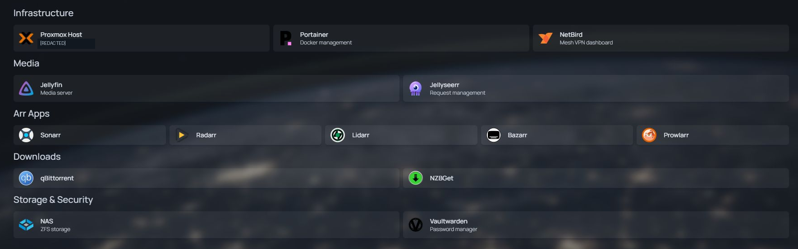
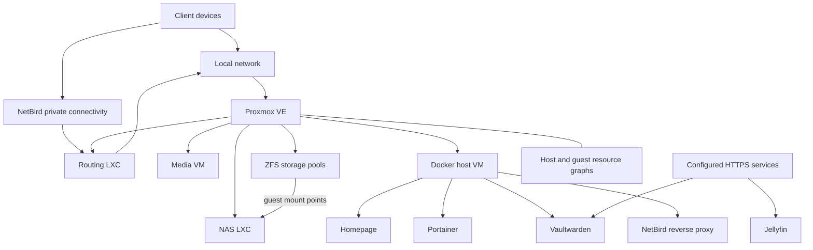
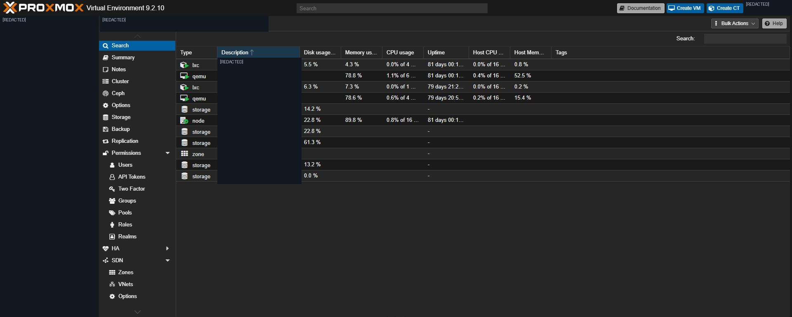
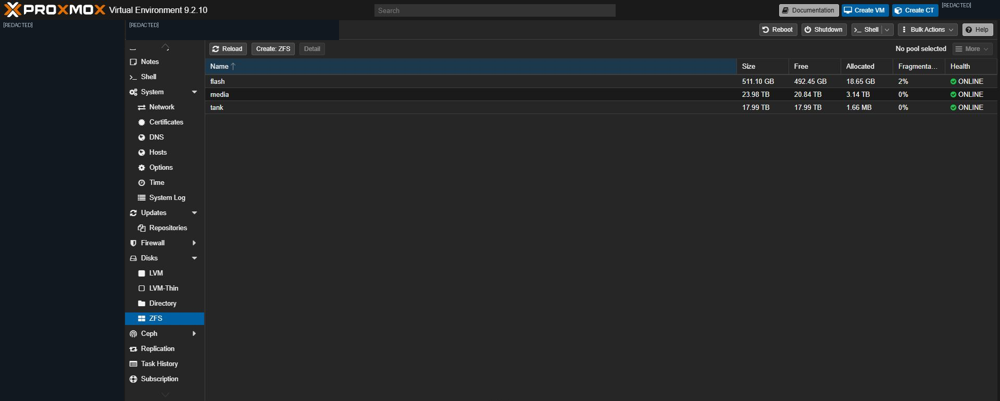
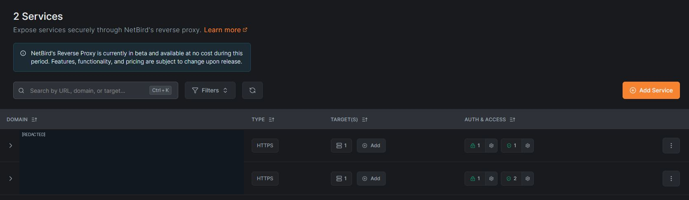
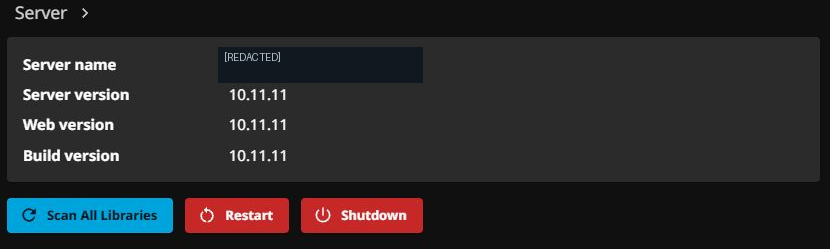

# Proxmox Home Lab

Self-hosted infrastructure built around Proxmox VE, Linux virtual machines, LXC containers, ZFS storage, Docker applications, and NetBird connectivity.

I built this lab to take my passion for building computers further and understand how the services I use every day work. It brings together media services, password management, storage, and infrastructure administration in one environment.



*The central service directory, organized by infrastructure and application role.*

**Current footprint:** one hypervisor · two VMs · two LXC containers · three ZFS pools · four containers on the inspected Docker host.

[Architecture](#architecture) · [Hardware](#hardware) · [Services](#containerized-services) · [Networking](#networking) · [Screenshots](#screenshots) · [Documentation](#documentation)

> **Environment snapshot — November 19, 2026.** Details come from read-only inspection of the actual lab. Service state reflects that inspection. Hosting relationships and access limits are recorded in the [service inventory](docs/services.md).

## Architecture



Proxmox hosts separate guests for storage, network routing, media, and general Docker workloads. ZFS pools provide backing storage for the NAS guest's large mount points. The Docker host runs Homepage, Portainer, Vaultwarden, and a NetBird reverse-proxy container.

NetBird also has two HTTPS service entries associated with Jellyfin and Vaultwarden. Those entries are shown separately because their backend target configuration and end-to-end access were not tested. Individual media applications are not mapped to the media VM until their placement is confirmed.

[Architecture details](docs/architecture.md) · [Editable diagram](assets/diagrams/architecture.mmd)

## Hardware

### Proxmox Host

| Component | Reported configuration |
| --- | --- |
| Processor | Intel Core i5-14400, one socket |
| Logical CPUs | 16 |
| Memory | 15.34 GiB reported by Proxmox |
| Hypervisor | Proxmox VE 9.2.10 |
| Boot mode | EFI with Secure Boot |
| Storage | Three ZFS pools, plus local and LVM-backed storage entries |

Pool capacities are listed below. Physical disk models, device count, and redundancy layout have not been verified.

## Virtualization

### NAS LXC

An unprivileged Ubuntu container assigned to the storage role.

- 4 CPU cores.
- 3.02 GiB RAM and 1 GiB swap.
- 20G configured root disk.
- Two large ZFS-backed mounts configured as 20000G and 12000G.
- A separate 16G mount.

### Network Routing LXC

A dedicated LXC guest appears as an Ubuntu 22.04 NetBird peer and the active routing peer for the configured LAN resource.

- 1 CPU shown in the Proxmox inventory.
- Active routing and masquerade configuration visible in NetBird.
- Private connectivity managed separately from application containers.

### Media VM

A running QEMU VM assigned to the media role, with 6 CPUs, 8 GiB RAM, and a 42 GiB boot disk.

The guest has no configured guest agent. The relationship between this VM and individual media-service endpoints remains an open verification item.

### Docker Host VM

A separate QEMU VM corresponds by hostname and CPU count to the host shown in Portainer.

- 4 CPUs.
- Approximately 2.98 GiB RAM reported by Proxmox.
- 64 GiB boot disk.
- Ubuntu 26.04 LTS reported by Portainer.
- Docker Engine 29.7.2.

[Guest organization and evidence](docs/architecture.md)

## Containerized Services

### Homepage

The main entry point for the lab, grouping infrastructure, media, automation, downloads, storage, and security services.

Its dashboard displays CPU, free-memory, and free-disk widgets. Portainer confirms the Homepage container and reports it as healthy.

### Portainer

Portainer Community Edition provides a browser interface for the local Docker environment.

| Inspected environment | Reported value |
| --- | --- |
| Portainer | CE 2.45.0 LTS |
| Docker Engine | 29.7.2 |
| Containers | 4 running; 0 stopped |
| Health results | 2 healthy; 0 unhealthy |
| Stacks | 3 |
| Volumes | 3 |
| Networks | 8 |

The container list contains Homepage, Portainer, Vaultwarden, and the NetBird reverse proxy. This inventory covers one Docker host; it is not a count of every application in the lab.

### Vaultwarden

A password-management service deployed from the Vaultwarden server image in its own stack. Portainer reports its container as healthy, and NetBird lists an HTTPS service entry for it.

The existing browser tab remained on a loading screen during inspection. Vault contents, credentials, and administrative secrets were not opened.

### NetBird Reverse Proxy

A running container using the NetBird reverse-proxy image. NetBird's service interface lists two HTTPS entries associated with Jellyfin and Vaultwarden, with authentication and access-control indicators.

The entries verify configured service access points. Detailed policies, certificate handling, and remote access behavior require separate verification.

## Media Services

### Jellyfin

Jellyfin provides the lab's media-server interface. The library interface and administration dashboard both loaded, and the server, web, and build versions reported **10.11.11**.

The captured administration view shows the server version while excluding media details and user activity. Playback and transcoding were not exercised.

### Seerr / Jellyseerr

The dashboard labels the request-management service as Jellyseerr; the destination identifies itself as **Seerr Stable 3.4.1**.

The discovery and request interface was accessible. No request was submitted, and connections to library-management applications were not inspected.

### Sonarr

Sonarr provides series organization and automation. Its System page confirms version **4.0.19.2979**, a LinuxServer.io package, Docker hosting, and .NET and SQLite components.

The interface was populated and displayed an available-update warning. Sonarr is not among the four containers on the inspected Portainer host, so its exact host mapping remains separate from that inventory.

### Bazarr

Bazarr provides subtitle management. A populated series interface was accessible during inspection. Subtitle jobs and integration settings were not exercised.

### Other Linked Applications

| Application | Role | Access result |
| --- | --- | --- |
| Radarr | Movie organization and automation | Login page |
| Lidarr | Music organization and automation | Authentication setup requirement |
| Prowlarr | Indexer management | Login page |
| qBittorrent | Download client | WebUI login page |
| NZBGet | Download client | Browser authentication error |

These applications are linked from Homepage. Their hosting, integrations, and workflows remain unverified. No automated request-to-download pipeline is asserted from the links alone.

[Complete service inventory](docs/services.md)

## Storage

The host's ZFS view reports three pools:

| Pool | Reported size | Reported free | State |
| --- | --- | --- | --- |
| flash | 511.10 GB | 492.45 GB | ONLINE |
| media | 23.98 TB | 20.84 TB | ONLINE |
| tank | 17.99 TB | 17.99 TB | ONLINE |

The NAS guest's two large mounts total **32000G as configured**, supporting the approximate 32 TB description at the guest-allocation level. Pool size, configured allocation, and usable network-share capacity are distinct measurements.

Homepage includes a file-share link for the NAS. Export protocol, Samba configuration, share permissions, and application mounts have not been verified. The NAS icon does not establish a TrueNAS installation.

[Storage layers and mount details](docs/storage.md)

## Networking

### Private Remote Connectivity

NetBird's dashboard lists desktop, laptop, phone, and LXC peers. Its Networks interface shows one active LAN resource, one active policy, and one active routing peer matching the routing LXC.

The routing peer has masquerade enabled. High Availability is shown as inactive. The older Routes interface contains no entries; the LAN resource is configured through Networks.

### Reverse Proxy and HTTPS

Two HTTPS service entries are configured for Jellyfin and Vaultwarden. The lab also runs a NetBird reverse-proxy container.

Private domains, addressing, and administrative endpoints are omitted from this repository. External reachability, effective authentication rules, and backend target configuration were not tested.

### DNS

The inspected NetBird Nameservers and Zones views contain no custom entries. The LAN resolver arrangement and external DNS configuration remain undocumented until verified.

[Networking and security details](docs/networking.md)

## Monitoring and Maintenance

### Infrastructure Resources

Proxmox provides host and guest graphs for CPU, memory, network traffic, disk I/O, and pressure metrics. Its ZFS interface reports pool capacity and health.

Portainer adds container-state and health visibility. Homepage provides resource widgets, and Sonarr exposes application health and disk-space information.

### Logs and Updates

Docker reports the json-file logging driver. Proxmox's visible task history includes successful package-database refreshes. Sonarr and Portainer display available-update notices.

Installed patch history, log rotation, retention, centralized collection, and alert delivery were not verified. No dedicated monitoring server has been confirmed.

### Backups and Recovery

The inspected Proxmox datacenter Backup list contains no scheduled jobs. One NAS mount has a backup inclusion flag, but completed backups and restore tests were not verified.

[Monitoring, maintenance, and recovery evidence](docs/monitoring.md)

## Security

The verified security-related configuration includes:

- An unprivileged NAS LXC.
- NetBird private connectivity with a configured LAN resource and policy.
- HTTPS service entries with authentication and access-control indicators.
- Application login or setup barriers on several linked endpoints.
- EFI Secure Boot reported by the hypervisor.

The documentation excludes credentials, tokens, keys, internal addresses, private domains, account identifiers, personal media, and raw logs. Original screenshots are kept outside Git; only reviewed, sanitized captures are included.

Firewall rules, public exposure, detailed proxy policies, and a complete access-control audit remain outside the verified scope.

## Technologies

| Area | Verified technologies |
| --- | --- |
| Virtualization | Proxmox VE, QEMU VMs, LXC |
| Operating systems | Linux, Ubuntu |
| Containers | Docker Engine, Portainer CE |
| Storage | ZFS, LVM-backed guest disks, LXC mount points |
| Connectivity | NetBird, LAN routing, HTTPS reverse proxy |
| Applications | Homepage, Vaultwarden, Jellyfin, Seerr, Sonarr, Bazarr |
| Operational visibility | Proxmox graphs, Docker health results, application health pages |

Additional linked applications and their access limits are listed in [services.md](docs/services.md).

## Repository Structure

```text
homelab-infrastructure/
├── README.md
├── .gitignore
├── docs/
│   ├── architecture.md
│   ├── services.md
│   ├── networking.md
│   ├── storage.md
│   ├── monitoring.md
│   └── lessons-learned.md
└── assets/
    ├── diagrams/
    │   └── architecture.mmd
    └── screenshots/
        └── eight sanitized captures
```

This repository documents the running environment. Deployment manifests and automation will be added when actual configurations can be inspected and safely sanitized.

## Screenshots

Real captures from the inspected environment, with crops and opaque redactions applied before committing.

### Proxmox Host


*Host resource summary and historical CPU, load, and memory graphs.*

### Virtual Machines and LXC Containers



*Two running QEMU VMs and two LXC guests. Guest and host identifiers are redacted.*

### ZFS Storage



*Three pools with reported capacity, allocation, and ONLINE state.*

### Docker Services


*The inspected Docker host's four containers, including health and image information. Network details are redacted.*

### HTTPS Reverse Proxy



*Two configured HTTPS service entries, with private domains removed.*

### Sonarr System Health


*Application version, Docker hosting, disk-space information, and an update warning.*

### Jellyfin Administration



*Server and web version information, cropped to exclude user activity and media details.*

## Skills Demonstrated

The current environment provides practical examples of:

- Organizing virtual machines and unprivileged Linux containers.
- Allocating compute and storage resources across guest roles.
- Operating Docker services and interpreting container health.
- Relating ZFS pools to guest storage allocations.
- Managing private connectivity and reverse-proxy service entries.
- Using infrastructure and application interfaces to investigate system state.

Specific design rationales and personal troubleshooting examples can be added to [lessons learned](docs/lessons-learned.md) when confirmed.

## Future Improvements

Potential next steps identified from the inspection; these are proposed work, not deployed features:

- Verify and document application-to-guest placement and NAS share relationships.
- Establish backup coverage and record a successful restore test.
- Review resource trends and application update notices.
- Document proxy authentication rules and validate remote access.
- Evaluate dedicated availability monitoring and alert delivery.
- Capture sanitized deployment configuration for repeatable maintenance.

## Documentation

| Document | Contents |
| --- | --- |
| [Architecture](docs/architecture.md) | Guest roles, hosting evidence, and failure boundaries |
| [Services](docs/services.md) | Service inventory, state, and inspection limits |
| [Networking](docs/networking.md) | NetBird routing, reverse proxy, DNS, and security |
| [Storage](docs/storage.md) | Pool capacities, NAS mounts, and share-verification gaps |
| [Monitoring](docs/monitoring.md) | Metrics, logs, maintenance, and backup evidence |
| [Lessons learned](docs/lessons-learned.md) | Motivation, findings, and owner-review questions |

Keep future updates grounded in inspected configuration, sanitize evidence before staging, and submit changes through a review branch. The repository remains private.

<sub>Presentation structure inspired by [ParampPathak/proxmox-homelab](https://github.com/ParampPathak/proxmox-homelab); descriptions and evidence reflect this lab.</sub>
