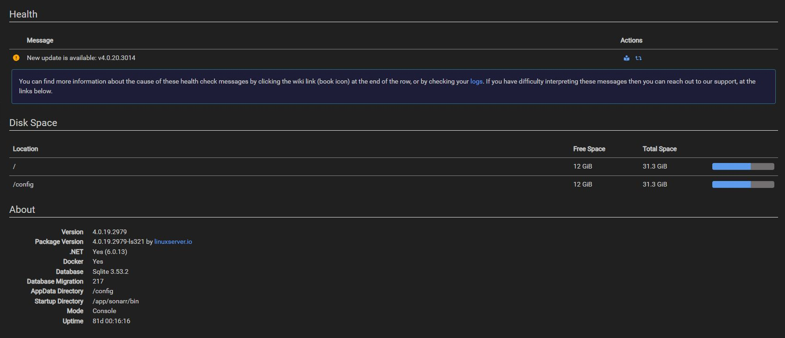

# Monitoring and maintenance

Observed November 19, 2026. This document separates actual interface evidence from unverified operating procedures.

## Resource and health visibility

| Source | Inspected information | Interpretation limit |
| --- | --- | --- |
| Proxmox host summary | CPU, load, memory, swap, disk space and time-series graphs | Resource observations; no availability SLA or alerting verification |
| Proxmox guest inventory and summaries | Guest type, running state, CPU/RAM allocation and uptime | Running guests do not prove application health |
| Proxmox ZFS view | Size, free space, allocation, fragmentation and ONLINE state | Does not establish backup integrity or device-health history |
| Portainer | One local environment; four running containers; two healthy; zero unhealthy | Health labels apply only to configured checks in this environment |
| Homepage | CPU, free-memory and free-disk widgets | Widget scope/collection configuration was not independently inspected |
| Sonarr System | Health warning, disk-space display, version and Docker details | No download or automation workflow exercised |
| Jellyfin admin | Server version, dashboard and resource-path information | No playback, transcoding or load test performed |

Sonarr showed one warning that a newer version was available. Portainer also advertised a newer release. The Proxmox host summary displayed a repository-status warning. These are inspection findings only; no updates or repository changes were made.

No dedicated monitoring server, synthetic uptime checks, alert delivery, centralized logging or dashboard such as Grafana was confirmed. Built-in graphs are the demonstrated monitoring mechanism.

## Logs and maintenance evidence

The visible Proxmox task list contained successful package-database refreshes. Refreshing package metadata does not establish installed updates or a tested patch process.

Portainer's Docker host details report the json-file logging driver and overlayfs storage driver. Logging driver configuration alone does not verify rotation, retention, external collection or incident procedures. Raw application logs and sensitive event records are not included.

## Backups and recovery

The inspected Proxmox datacenter Backup list had no jobs. One NAS mount was flagged for backup inclusion, but no completed backup, backup destination, retention schedule or restore exercise was verified.

The UI contains backup-related controls in several products. Their existence is not evidence of configured protection. Recovery point/time objectives and offsite copies remain open questions.

## Resource-management observations

At inspection, the host reported about 90% RAM use and some swap use. The NAS and both VMs were running, and their resource allocations were visible. The host reported about 81 days uptime and some guests about 79–81 days; these counters are not an independently measured reliability record.

The single visible hypervisor and inactive/none HA indicators establish no tested failover. Review memory trends, backup evidence and service warnings before making reliability claims. This documentation task made no corrective changes.
