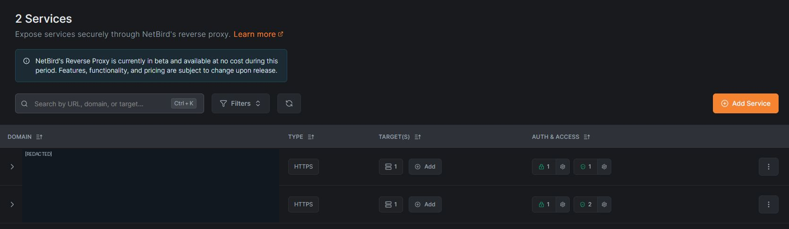

# Networking and security

This is a high-level account of the configuration inspected on November 19, 2026. Administrative URLs, internal addresses, subnet values, hostnames and private service domains are intentionally excluded.

## Local access

Homepage links to infrastructure interfaces and self-hosted applications on the local network. The authenticated browser could reach Proxmox, Portainer, Jellyfin, NetBird, Seerr, Sonarr and Bazarr. Some application endpoints presented authentication or setup barriers; see the [inventory](services.md).

The dashboard includes direct HTTP links to several applications. HTTPS is observed for Proxmox, Portainer and the reverse-proxy entries, but encryption is not claimed for all LAN traffic. Firewall policy and public Internet reachability were not tested.

## Private connectivity

NetBird's peer view listed a desktop, a laptop, a phone and an Ubuntu 22.04 LXC peer. The desktop and LXC peer were last seen just now during inspection; the others had older last-seen values.

The Networks interface contained one network with:

- One active LAN resource.
- One active policy.
- One active routing peer matching the routing LXC.
- Masquerade enabled for that peer.
- High Availability shown as inactive.

The legacy Routes view was empty. This does not contradict the deployed Networks resource; these are separate interface concepts. No remote client session was initiated to prove full LAN access or policy enforcement.

## Reverse proxy

NetBird lists two HTTPS services associated with Jellyfin and Vaultwarden. Each has one configured target, and the table shows authentication and access-control indicators. Portainer independently lists a running NetBird reverse-proxy container.

The exact authentication mechanisms, effective policy rules, target addressing, certificate management, external DNS records and public ingress path were not inspected. A configured HTTPS entry does not prove that every route works or that every administrative service is private.

## DNS

NetBird's Nameservers and Zones views contained no custom entries. This observation is scoped to those views. It does not establish the LAN's DNS provider, DHCP behavior, upstream resolver, public DNS configuration or whether another DNS server exists elsewhere. No separate DNS-server component is asserted in the architecture diagram.

## Observed security boundaries

The NAS LXC reports Unprivileged: Yes. Several application endpoints enforce a login or setup barrier, and existing authenticated infrastructure sessions were reused. The host reports EFI Secure Boot. These observations do not amount to an access-control audit.

Vaultwarden was documented from its container state and loading page without opening stored secrets. No credentials, tokens, API-key pages, browser profiles or authentication files were accessed. No security settings, account permissions, firewall rules or network configuration were changed.

## Documentation privacy

Committed screenshots use opaque redactions and cropping. Original captures remain outside Git. Published documentation omits addresses, private domains, internal hostnames, account identifiers, personal media, activity records and secrets. Repository privacy is an additional control, not a substitute for sanitization.
