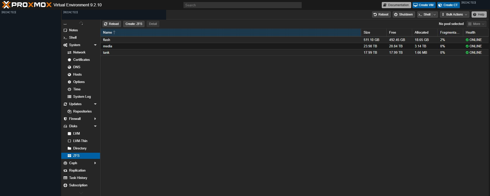

# Storage

The storage layers below were inspected through Proxmox on November 19, 2026. Capacity units are transcribed as displayed rather than converted or equated across layers.

## Host pools

| Pool label shown by Proxmox | Reported size | Reported free | Allocated | Health |
| --- | --- | --- | --- | --- |
| flash | 511.10 GB | 492.45 GB | 18.65 GB | ONLINE |
| media | 23.98 TB | 20.84 TB | 3.14 TB | ONLINE |
| tank | 17.99 TB | 17.99 TB | 1.66 MB | ONLINE |

The pool list also reported fragmentation of 2%, 0% and 0%, respectively. These are UI observations at capture time. ONLINE does not substitute for a scrub history, device-health review or restore test. Disk models, vdev layout, redundancy and physical/raw capacity were not inspected.

## NAS guest allocations

The NAS is an unprivileged Ubuntu LXC with the following resource entries:

| Resource | Backing storage label | Configured size | Guest mount path |
| --- | --- | --- | --- |
| Root disk | local-lvm | 20G | Root filesystem |
| Mount point 0 | media | 20000G | /media |
| Mount point 1 | local-lvm | 16G | /docker |
| Mount point 2 | tank | 12000G | /tank |

The two large mount entries total **32000G as configured**. This is the inspected basis for the owner's approximate 32 TB description. It is not a measurement of available SMB capacity, physical disk capacity, redundancy-adjusted usable capacity or occupied data. Pool size and dataset/guest allocation are different layers and should not be summed into a single headline capacity.

The third mount's path does not prove that a Docker engine is running inside this guest.

## Network file sharing

Homepage's NAS link points to a network file-share location. The guest role and mounted storage are verified, but the share was not opened because it is not a browser management dashboard and may expose personal files. The actual export protocol, Samba daemon, permissions, share capacity and client mounts remain unverified. No TrueNAS deployment is inferred from the dashboard icon.

## Backup boundary

One large NAS mount has a backup inclusion flag in its Proxmox resource entry. That flag is not proof of an existing backup. The datacenter Backup view listed no scheduled jobs. Backup destinations, snapshot schedules, replication, retention and successful restores were not verified.
